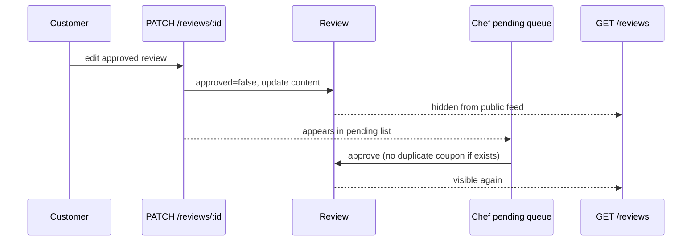

# Implementation Plan — Slice 11: Customer nav, profile receipts, unified reviews, re-approval, app-wide pull-to-refresh

## Metadata

- Status: **COMPLETE**
- Plan ID: `slice-11-customer-nav-reviews-ptr-2026-08-28`
- Parent plan: `post-launch-ux-batch-2026-08-15` (Slices 1–10 complete; PR #26 merged)
- Issue: `local/customer-nav-reviews-ptr` (placeholder until GitHub issue created)
- Base: `origin/main` after PR #26 merge
- Branch (on approval): `feature/local-customer-nav-reviews-ptr`
- Rollback checkpoint (on approval): `checkpoint/customer-nav-reviews-ptr-2026-08-28`
- Created: 2026-08-28
- Last updated: 2026-08-31
- Merged: PR [#27](https://github.com/loganware05/TrapHouseKitchen/pull/27) → `76e21a0` on `main` (2026-09-01)

## Request (Captain)

1. **Customer bottom/sidebar tabs** should be: **Home**, **Reviews**, **Requests**, **Orders** (replace Menu + Profile tabs). **Menu** remains reachable via Home **See all** / **Browse** / category jumps — not a tab item.
2. **Profile** (header avatar link) should include a **collapsible receipts dropdown** showing **up to the last 3** completed receipts.
3. **Reviews tab** should show **public (approved) reviews** and the **customer’s pending reviews** in one place.
4. **Review edits** must **re-enter the approval queue** — edited reviews are hidden from the public feed until the chef re-approves.
5. **Pull-to-refresh** should work on **every customer and chef tab view**, and become a **default Captain’s Compass skill** for iOS/Capacitor apps unless explicitly waived.

## Current behavior

| Area | Today |
|------|--------|
| Customer nav | Home · Menu · **Orders** · **Profile** (`Layout.tsx`) |
| Profile receipts | Always-visible “Recent receipts” section, up to **5** (`selectRecentReceipts(..., 5)`) |
| Profile reviews | Inline “Community reviews” preview (3 items) + links to `/reviews` and `/reviews/my` |
| Reviews tab | Not in nav; `/reviews` = public approved only; `/reviews/my` = all own reviews + coupons + inline edit |
| Review `PATCH` | Updates `rating`/`comment` but **keeps `approved: true`** — edits stay public immediately |
| Re-approve coupon | `approveReviewWithOptionalCoupon` always tries to mint; would **fail** if `sourceReviewId` coupon already exists |
| Pull-to-refresh | Home, Menu, Orders, Chef Dashboard, Chef Orders only (`mobile-ux-patterns` skill lists same set) |
| Active orders | Primary surface is `/orders` tab — **no active-order card on Home** today |

## Desired behavior

### A — Customer navigation

| Tab | Route | Notes |
|-----|-------|-------|
| Home | `/` | Hub; menu via See all / Browse / category jumps (unchanged) |
| Reviews | `/reviews` | Promoted to primary nav; community + your reviews |
| Requests | `/dish-requests` | Promoted to primary nav |
| Orders | `/orders` | **Stays** as primary tab — active + history orders |

- **Menu** (`/menu`, `/menu/:id`) — off-tab; linked from Home strips and category jumps.
- **Profile** remains reachable via header user icon (`/profile`) — not a bottom-tab item.
- Desktop sidebar mirrors mobile bottom nav labels and active-state rules.

### B — Profile receipts dropdown

1. Replace always-visible receipts block with a **disclosure / accordion** (“Receipts”) default **collapsed**.
2. Expanded state shows **at most 3** newest completed+paid receipts (`selectRecentReceipts(..., 3)`).
3. Footer link: **“View all orders”** → `/orders`.
4. Remove redundant **Community reviews** preview and duplicate “More” links that the new tabs cover (My reviews, All community reviews, Dish requests).

### C — Unified Reviews tab

When logged in as customer, `/reviews` renders two sections **in this order**:

1. **Community reviews** (top)
   - Existing public approved feed with sort controls.
2. **Your reviews** (below)
   - Approved and pending own reviews with status badges.
   - **Edit** (re-approval flow) and **Delete** on own reviews.
   - Coupon earned / saved-codes summary (migrated from `MyReviewsPage`).

When logged out, only Community reviews section shows.

- `/reviews/my` → **redirect** to `/reviews` (preserve bookmarks).
- “Write review” CTA remains; still routes to `/reviews/new`.

### D — Review edit → re-approval

**Backend (`PATCH /reviews/:id`)**

1. If `rating` or `comment` changes and review was `approved: true`, set `approved: false`.
2. Response message: *“Review updated and sent back for chef approval.”*
3. Public `GET /reviews` already filters `approved: true` — edited review disappears from public feed immediately.

**Backend (`approveReviewWithOptionalCoupon`)**

4. On re-approve: if a coupon with `sourceReviewId = reviewId` already exists, **approve only** — do **not** mint a duplicate coupon.

**Frontend**

5. After save, show re-approval toast; invalidate `reviews`, `myReviews`, chef pending queries.
6. Edit UI copy: *“Editing will remove this review from the public feed until the chef approves it again.”*

**Chef**

7. Re-submitted reviews appear in existing pending queue (`approved: false`) — no chef UI change required beyond optional “Edited” badge if `updatedAt > createdAt`.

### E — App-wide pull-to-refresh + skill

1. Introduce a **route-scoped refresh registry** (React context in `Layout` or lightweight store):
   - Each routable page registers `onRefresh: () => Promise<void>` on mount.
   - Single `PullToRefresh` wrapper in `Layout` calls the active route’s handler.
   - Disabled while `CheckoutSheet` is open (existing rule).
2. Migrate existing per-page `PullToRefresh` wrappers to the registry (avoid double handlers).
3. Ensure refresh on **all** primary tab routes and profile:
   - Customer: Home, Menu, Requests, Reviews, Profile, Orders (off-tab)
   - Chef: Dashboard, Menu, Orders, Reviews, Requests
4. Update `.cursor/skills/mobile-ux-patterns/SKILL.md` surfaces table.
5. Add **`.cursor/skills/ios-pull-to-refresh/SKILL.md`** — default expectation: every iOS/Capacitor screen exposes pull-to-refresh unless Captain documents an exception in the plan.

## Non-goals

- Changing chef nav structure (already matches Requests + Reviews pattern).
- Messaging-system coupon delivery (still waiting list).
- Removing `/orders` route or rewriting order-tracking E2E from scratch.
- Native Swift pull-to-refresh (Capacitor WebView uses existing touch hook).

## Assumptions

| # | Assumption | If wrong |
|---|------------|----------|
| 1 | Active orders can move to a **Home banner** + `/orders` deep link | Captain prefers a different entry point |
| 2 | Profile keeps allergen, dietary, spend, and saved-cards sections as-is | Scope expands to profile redesign |
| 3 | “Last 3 receipts” = 3 most recent **completed+paid** within review window (same filter as today) | Captain wants all-time last 3 regardless of window |
| 4 | Coupons UI moves with “Your reviews” into `/reviews` | Captain wants coupons only on Profile |
| 5 | Delete review remains allowed without re-approval | Captain wants delete restricted |

## Captain decisions (2026-08-30)

| Topic | Decision |
|-------|----------|
| Customer tabs | **Home · Reviews · Requests · Orders** |
| Menu tab | **Removed** from nav; Home See all / Browse / category jumps unchanged |
| Orders tab | **Keep** as primary tab |
| Receipts filter | 3 most recent **completed+paid** within **30-day** review window |
| Reviews tab order | **Community reviews first**, then your approved + pending reviews |

## Design notes

### Navigation active-state

```ts
// Layout pathMatchesNav additions
'/dish-requests' → pathname starts with /dish-requests
'/reviews'       → /reviews, /reviews/new (not /reviews/my — redirects)
```

### Review re-approval sequence



### Pull-to-refresh registry (sketch)

```ts
// PullToRefreshProvider in Layout
registerRefresh(fn) on route mount
unregister on unmount
Layout PullToRefresh → activeRefresh ?? defaultInvalidateAll
```

## Incremental delivery (recommended PR slices)

Work is split so each slice is shippable and testable. **Prefer 2 PRs** if Captain wants fewer merges; **3 PRs** if smaller review units are preferred.

### Slice 11A — Navigation (PR #1)

| Task | Files (indicative) |
|------|---------------------|
| Customer nav → Home, Reviews, Requests, Orders | `Layout.tsx` |
| `pathMatchesNav` for `/reviews`, `/dish-requests` | `Layout.tsx` |
| Menu off-tab; Home links unchanged | `HomePage.tsx` (verify only) |
| Update E2E nav selectors | `e2e/mobile.spec.ts`, `e2e/review-receipts.spec.ts`, etc. |

**Acceptance:** Mobile bottom nav shows Home · Reviews · Requests · Orders; Menu reachable from Home; Profile via header.

### Slice 11B — Profile receipts dropdown (same PR as 11A or follow-up)

| Task | Files |
|------|-------|
| Collapsible receipts section, limit 3 | `ProfilePage.tsx`, `orderReceipt.ts` (default limit) |
| Remove community reviews preview + redundant More links | `ProfilePage.tsx` |
| Update profile E2E | `e2e/review-receipts.spec.ts` |

**Acceptance:** Profile loads collapsed receipts; expand shows ≤3; “View all orders” works.

### Slice 11C — Unified Reviews tab (PR #2)

| Task | Files |
|------|-------|
| Merge `MyReviewsPage` content into `ReviewsPage` | `ReviewsPage.tsx`, optionally extract `CustomerReviewsSection.tsx` |
| Redirect `/reviews/my` → `/reviews` | `App.tsx` |
| Add `PullToRefresh` via registry or page wrapper | `ReviewsPage.tsx` |
| Nav points Reviews tab to unified page | already in 11A |

**Acceptance:** Reviews tab shows pending + public; coupons visible; write/edit flows work.

### Slice 11D — Review re-approval (PR #2 or #3)

| Task | Files |
|------|-------|
| `PATCH` sets `approved: false` when content changes on approved review | `review.controller.ts` |
| Re-approve skips duplicate coupon mint | `couponGateway.service.ts` |
| Integration tests | `review-flow.test.ts`, `coupon-gateways.test.ts` |
| Frontend copy + invalidation | `ReviewsPage.tsx` (or extracted component) |

**Acceptance:** Edit approved review → hidden from public → chef pending → re-approve → public again; no duplicate coupon.

### Slice 11E — App-wide pull-to-refresh + skills (PR #3)

| Task | Files |
|------|-------|
| `PullToRefreshProvider` + Layout-level wrapper | new `contexts/PullToRefreshContext.tsx`, `Layout.tsx` |
| Register handlers from all tab pages | Home, Menu, DishRequests, Reviews, Profile, Orders, chef pages |
| Remove duplicate per-page wrappers | affected pages |
| Skill: `ios-pull-to-refresh/SKILL.md` | `.cursor/skills/` |
| Update `mobile-ux-patterns/SKILL.md` | surfaces table |
| Selftest unchanged; optional E2E touch on Reviews/Requests | `e2e/mobile.spec.ts` |

**Acceptance:** Pull at top on every primary tab refetches that screen’s data; checkout open disables pull.

## Validation

| Layer | Command / check |
|-------|-----------------|
| Backend unit + integration | `cd backend && npm run test:all` |
| Review re-approval | new cases in `review-flow.test.ts` |
| Coupon re-approve | extend `coupon-gateways.test.ts` |
| PTR logic | `cd frontend && npx tsx src/lib/pullToRefreshLogic.selftest.ts` |
| Frontend build | `npm run build --prefix frontend` |
| E2E (nav + reviews + PTR) | `e2e/mobile.spec.ts`, `e2e/review-receipts.spec.ts`, `e2e/chef-flow.spec.ts` |
| Accessibility | labels on receipts disclosure, review edit warning |
| Evidence | `.agent/evidence/customer-nav-reviews-ptr-YYYYMMDD/` |

## Rollback

1. Revert to checkpoint tag `checkpoint/customer-nav-reviews-ptr-2026-08-28`.
2. Backend-only rollback of re-approval: redeploy prior API; frontend edit copy harmless.
3. PTR registry rollback: restore per-page `PullToRefresh` wrappers (documented in PR).

## Autonomy budget

- Max **3** iterations on E2E nav/touch flakes.
- Max **2** iterations on coupon re-approve edge cases.

## Documentation updates (on completion)

- `PROGRESS.md`, `CHANGELOG.md`, `TESTING.md`
- `DECISIONS.md` — ADR-005: review edits require re-approval
- `mobile-ux-patterns` + new `ios-pull-to-refresh` skill

## Approval Record

- **Status:** COMPLETE (merged)
- **Approved by:** Captain (Logan)
- **Approval date:** 2026-08-30
- **Merged:** 2026-09-01 — PR #27 (`76e21a0`)
- **Captain notes:** Tabs = Home, Reviews, Requests, Orders; Menu via Home; Orders tab kept; receipts = 3 within 30-day window below Legal; Reviews = community first then yours; profile allergen/saved-cards/dietary removed; Orders = quick reorder + saved/used codes
